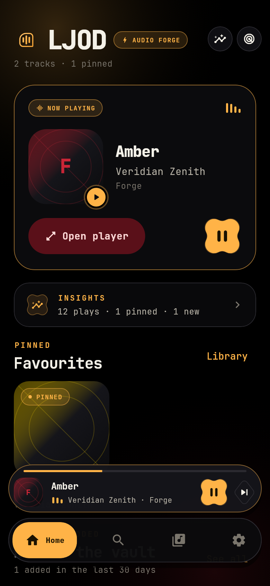
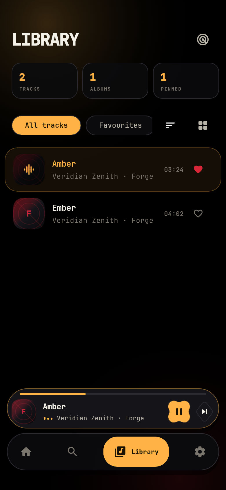
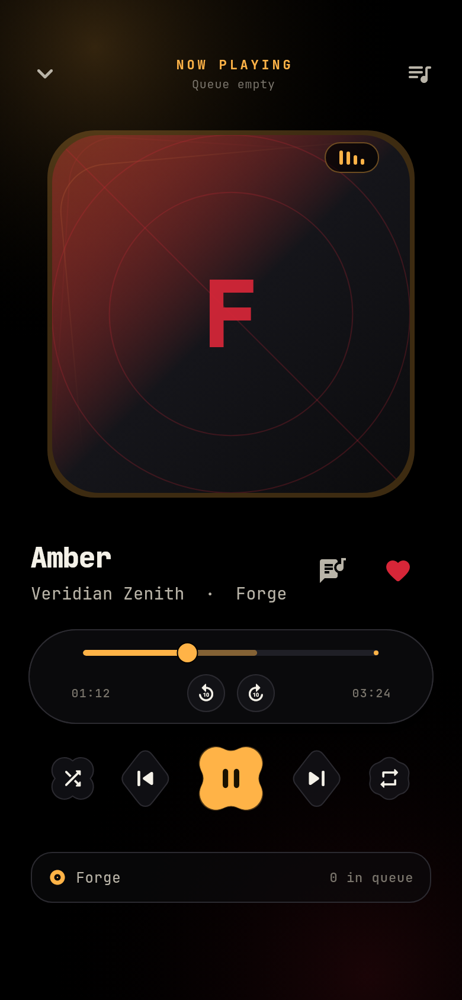
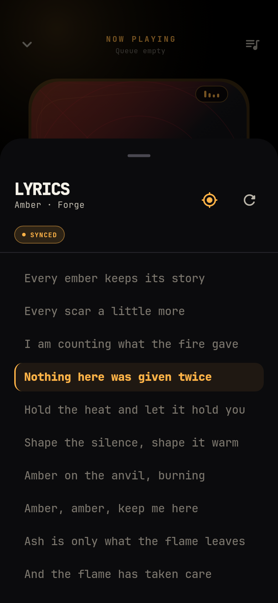
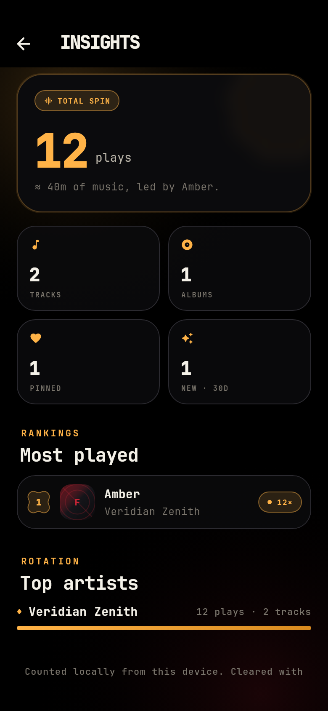
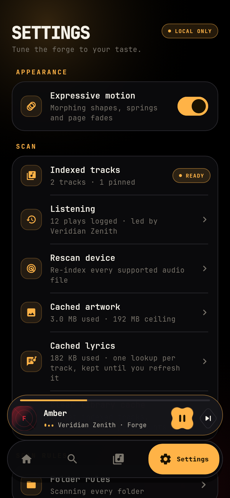

# Ljod

A local-first audio player forged by Veridian Zenith. Ljod reads the music
already on your device, keeps everything offline, and pairs an amber-on-black
blueprint aesthetic with Material 3 Expressive geometry.

<p align="center">
  
  
  
</p>
<p align="center">
  
  
  
</p>

## Features

- MediaStore-backed Android library scan, with desktop folders as a dev fallback
- Embedded tag and cover-art extraction, bounded artwork cache, SQLite library cache
- Background playback and media notification via `just_audio` + `audio_service`
- Queue, shuffle, repeat, favourites and play history
- Synced and plain lyrics: sidecar `.lrc`/`.txt`, embedded tags, and an opt-in
  (off by default) LRCLIB lookup with on-disk caching
- Listening insights: most-played tracks, top artists, approximate listening time
- Folder rules (`all` / `only` / `exclude`, applied recursively)
- True-black OLED surfaces, with only motion, lyrics lookup, favorites-first
  sorting and folder rules exposed as persistent settings
- On-device diagnostics log, so a crash is readable without developer options

## Install

Grab the signed APK from the
[releases page](https://github.com/Veridian-Zenith/ljod/releases). Android 15
(API 35) or newer is required.

## Build from source

```sh
flutter pub get
flutter run
flutter analyze
flutter test
```

See [docs/BUILDING.md](docs/BUILDING.md) for toolchain versions, Gradle details
and the two `local.properties` files.

## Documentation

| Document | Contents |
| --- | --- |
| [docs/ARCHITECTURE.md](docs/ARCHITECTURE.md) | layers, startup, library pipeline, database, playback, lyrics, limits |
| [docs/BUILDING.md](docs/BUILDING.md) | requirements, commands, Gradle, versioning |
| [docs/RELEASING.md](docs/RELEASING.md) | version bump, signing secrets, tag builds, verification |
| [docs/PRIVACY.md](docs/PRIVACY.md) | what is stored, permissions, the single outbound request |
| [docs/TROUBLESHOOTING.md](docs/TROUBLESHOOTING.md) | empty library, missing art or lyrics, build and signing errors |
| [docs/FAQ.md](docs/FAQ.md) | formats, offline behaviour, folder rules, backups |
| [CONTRIBUTING.md](CONTRIBUTING.md) | setup, code conventions, tests, commits |
| [CHANGELOG.md](CHANGELOG.md) | release history |

## Privacy

Everything stays on the device: the library lives in a local SQLite file, and
artwork and lyric caches sit in the app support directory. There is no account,
no analytics, no crash reporting and no ads.

The only outbound request is the LRCLIB lyrics lookup, which is **off by
default** and, when enabled, sends just the track title, artist, album (if set)
and duration — never audio or file paths. Each track is looked up **once**: the
answer (including "no lyrics" and "instrumental") is cached on disk, and nothing
is re-requested unless you refresh it from the lyrics sheet or clear the cache
in Settings.

Full detail in [docs/PRIVACY.md](docs/PRIVACY.md).

## Stack

- Flutter 3.47.9 / Dart 3.13+
- `material_ui` 1.9 (`StyleVariant.material3Expressive`)
- Riverpod 3, `just_audio`, `audio_service`, `sqflite`, `shared_preferences`, `dio`
- Bundled JetBrains Mono (no runtime font downloads)
- Gradle 9.8.2, AGP 9.4.1, Kotlin 2.4.20 (AGP built-in Kotlin), JDK 21

## Android

`MainActivity` extends `AudioServiceFragmentActivity` and exposes the
`dev.vz.ljod/media` method channel used to query MediaStore. Package and
namespace are `dev.vz.ljod` throughout; `minSdk 35`, `targetSdk 37`.

## Releasing

A tag push builds, signs, verifies and publishes the APK — no keystore is ever
committed. Signing material is passed as **content** (`ANDROID_KEYSTORE_BASE64`),
not as a path into the checkout.

```sh
# after bumping pubspec.yaml + lib/core/app_info.dart
git tag v0.3.1 && git push origin v0.3.1
```

The workflow checks the tag against the pubspec, builds with the four repository
secrets, verifies the signature with `apksigner`, removes the decoded key, and
publishes the release. Full procedure, secret names and local signing are in
[docs/RELEASING.md](docs/RELEASING.md).

## CI

`.github/workflows/ci.yml` runs on every push to `main`/`master` and on every
pull request: formatting check, `flutter analyze`, `flutter test`, then a debug
APK build (gated on the first three). Releases run from
`.github/workflows/release.yml` on `v*` tags.

## License

[Open Software License 3.0](LICENSE) — Copyright (c) 2026 Veridian Zenith.
You may use, modify and redistribute Ljod, including commercially, provided
distributed copies and derivative works remain under the same licence and
attribution notices are preserved.
